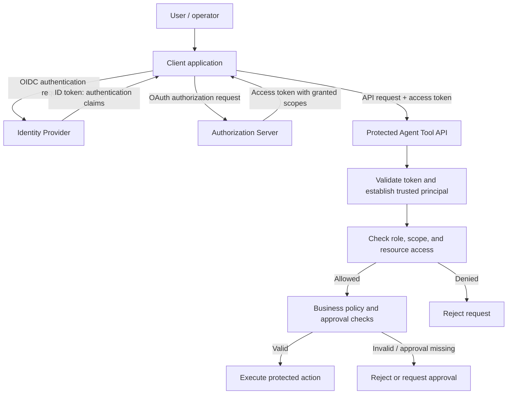
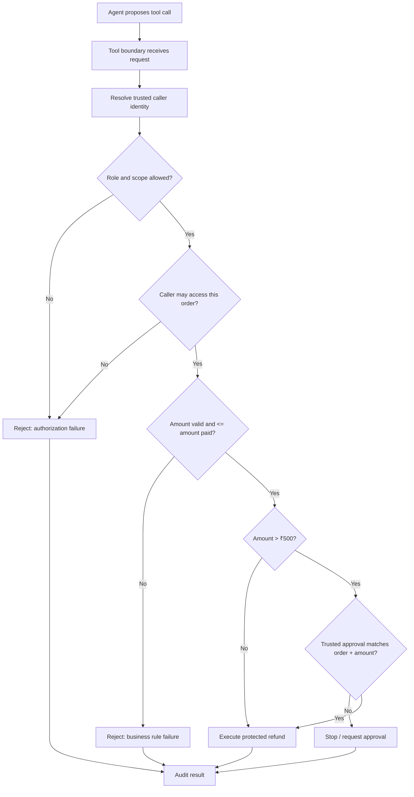

# Topic 1.1 — Editable Architecture Diagrams

These diagrams are source artifacts. Keep labels and arrows technically precise. OIDC establishes identity context; OAuth access tokens authorize calls to protected APIs. A diagram must not imply that an ID token is used as an API access token.

## Diagram A — Identity and API authorization

Teaching notes:
- OIDC ID tokens tell the client about the authenticated user; they are not interchangeable with access tokens.
- OAuth access tokens are presented to protected APIs and must be validated according to the issuer's contract.
- Scopes are one input to authorization, not a complete policy by themselves.
- A trusted principal must be created by the application/authentication layer, not by the LLM.

## Diagram B — Policy enforcement and safe execution

Teaching notes:
- The policy decision and policy enforcement can be logically separated, but enforcement must be unavoidable.
- A central policy engine can improve consistency and manageability; it also adds latency, availability, and operational dependencies.
- The resource-owning service should independently enforce critical invariants.
- Approval must come from a trusted workflow and be bound to the specific action.
- Production systems also need appropriate transaction semantics, durable audit, and idempotency controls.
